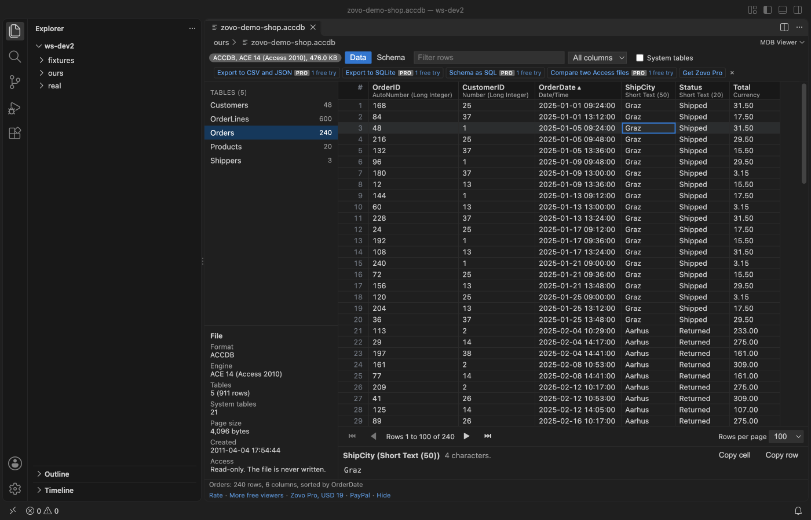

# MDB Viewer & ACCDB, Access DB

Open Microsoft Access databases (.mdb and .accdb) in VS Code, read-only: every table with its row count, the rows, and the schema. Made by Zovo.

Free, with no account and no network calls:

- Opens .mdb files from Access 97 to 2003 (Jet 3 and Jet 4), .accdb files from Access 2007 and later, and the compiled .mde and .accde files. Access does not need to be installed, and neither does a database driver.
- A table list with the row count of each table. System tables (MSys) are hidden until you tick System tables. Linked tables are listed by name.
- Rows in pages of 50 to 1,000. Click a column head to sort the whole table, type in the filter box to keep the rows that contain the text (in every column or in one), and step through the pages.
- Click a cell to see its whole value below the rows. Copy cell, Copy row (tab separated) or Cmd+C / Ctrl+C put it on the clipboard.
- Memo (Long Text) values show as plain text, line breaks kept. OLE objects and binary values show their size, the kind of data they hold (PNG, JPEG, PDF and others) and a hex view; attachments show their file names and sizes. Nothing inside them is opened or run.
- The Schema tab lists every column of every table with its Access type (Short Text with its length, Number size, Currency, Date/Time, Yes/No, AutoNumber and the rest) and whether it is required.
- A database with a password (a Jet 4 database password or an encrypted .accdb) asks for it before it shows anything. The password is not stored.

Zovo Pro: USD 19 once, for the Pro tools in every Zovo extension. Each Pro tool has 1 free try on your computer first:

- Export to CSV and JSON: every table as CSV files (one per table, in a folder) or as one JSON file, or the open table as CSV or JSON.
- Export to SQLite: every table with all its rows in one SQLite .db file. Attachments go to a side table with their bytes. The row counts are read back from the new file and shown next to the Access counts.
- Schema as SQL: CREATE TABLE statements for every table in the SQLite, PostgreSQL, MySQL or SQL Server dialect, with the column types mapped and AutoNumber written the way each dialect writes it.
- Compare two Access files: tables only in one file, columns added or removed, type changes and row counts per table, with a Markdown report.

## How to use it

- Click a .mdb or .accdb file in the Explorer. It opens in the viewer. Click a table on the left to see its rows.
- Data and Schema switch the main view. System tables shows the MSys tables in the list and in the schema.
- To try it without your own files, run MDB Viewer: Open the Sample ACCDB (or Open the Sample MDB) from the Command Palette. The samples hold a made-up tea and coffee shop.
- The Pro tools are in the Command Palette (MDB Viewer: ... (Pro)), in the Explorer right-click menu of a database file, in the viewer's title bar menu and in the small row at the end of the viewer toolbar. The row closes with its x for the rest of the session, and the setting `mdbViewer.showProTools` hides the Pro tools for good.

## What it reads, and what it does not

The viewer reads tables: their columns, types and rows. Queries, forms, reports, macros, VBA modules, indexes, keys and relationships are not shown, and the Schema as SQL tool does not write indexes or keys. A linked table is listed by name only, because its rows live in another file. A table with a rare column type that the reader does not support is listed with a note, and the other tables stay readable. A multi-value or version history column that cannot be read shows "(not read)" in its cells.

Dates are shown as Access stores them, without a time zone. Files up to 1 GB open.

## Files that are not Access databases

A file whose first bytes are not a Jet or ACE header gets a short note, with a button to open it in a hex editor when one is installed. A cut or damaged file gets a note that says so, and an empty file says it is empty. The viewer never switches the tab to another editor by itself, and it never writes to the database file.

## Privacy

The extension reads the file you open and nothing else. It makes no network calls, and nothing is uploaded or measured. The Pro tools write only the files you ask for. The links at the bottom of the viewer (Rate, More free viewers, Zovo Pro) open a page only when you click them, and the setting `mdbViewer.showSupportLinks` hides them.

## Settings

| Setting | Default | What it does |
|---|---|---|
| `mdbViewer.pageSize` | 100 | Rows per page in the data view. |
| `mdbViewer.showProTools` | true | Shows the Pro tools in menus, the palette and the toolbar row. |
| `mdbViewer.showSupportLinks` | true | Shows the Rate, More free viewers and Zovo Pro links. |
| `mdbViewer.askForRating` | true | Asks once for a rating after two good uses at least 30 minutes apart. |
| `zovo.mdb.trial.enabled` | true | Shows the 7-day trial button in the Zovo Pro panel. |

## Zovo Pro

One payment of USD 19 unlocks the Pro tools in every Zovo extension on your computers; a team of 5 is USD 59. The key works offline. Run Zovo Pro: Get Zovo Pro from the Command Palette. The Zovo Pro tab lists this extension's Pro tools and your free tries before any payment page opens. When the free try of a Pro tool is used, its next use opens the Zovo Pro panel, which also offers all Pro tools for 7 days, free, with no card. The trial starts only when you click that button.
